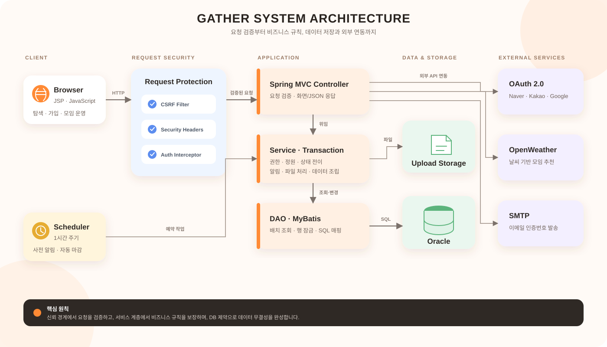

  
  <h3>취향과 지역, 날씨를 연결해 오늘 함께할 모임을 찾는 커뮤니티</h3>
  

    모임 탐색부터 개설, 참여 승인, 팔로우와 알림까지 
    오프라인 모임의 전체 흐름을 하나의 서비스로 구현했습니다.
  

---

## GATHER 소개

GATHER는 관심사는 같지만 함께할 사람을 찾기 어려운 사용자를 위한 지역 기반 모임 플랫폼입니다. 단순한 게시판에 머무르지 않고 사용자의 취향, 현재 위치, 날씨, 모임 인기도를 탐색 기준으로 활용합니다.

사용자는 이메일 또는 소셜 계정으로 가입하고, 원하는 모임을 검색하거나 직접 개설할 수 있습니다. 모임장은 참여 조건과 승인 방식을 설정하고 신청자를 관리하며, 참여자는 좋아요와 팔로우, 알림을 통해 관심 있는 모임과 사람의 변화를 계속 확인할 수 있습니다.

| 구분 | 내용 |
| --- | --- |
| 서비스 형태 | 취향·지역·날씨 기반 오프라인 모임 커뮤니티 |
| 핵심 사용자 흐름 | 가입 → 모임 탐색 → 개설/참여 → 승인 → 알림 |
| 서버 | Java 11, Spring MVC 5.3, JSP/JSTL |
| 데이터 | Oracle, MyBatis 3.5 |
| 외부 연동 | OpenWeather, Naver·Kakao·Google OAuth, SMTP |
| 실행 환경 | Maven, Tomcat 9, WAR 배포 |

## 구조

  

## 기술 스택

| 영역 | 기술 |
| --- | --- |
| Language | Java 11, JavaScript |
| Backend | Spring Framework 5.3.39, Spring MVC, Spring Transaction |
| View | JSP, JSTL, jQuery 3.7.1, Summernote, SweetAlert |
| Persistence | Oracle, MyBatis 3.5.19, MyBatis-Spring 2.1.2 |
| Build & Runtime | Maven, Tomcat 9, WAR |

 

## 둘러보기

